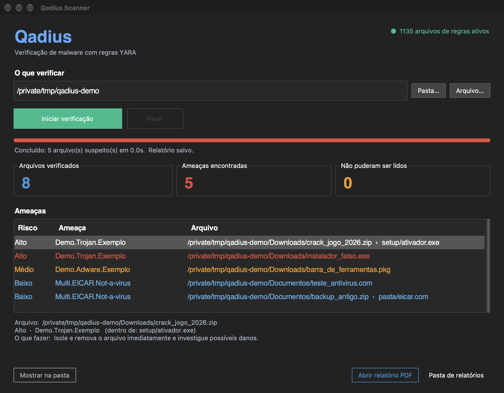

# Qadius Scanner

Verificador de malware com regras [YARA](https://virustotal.github.io/yara/). Escolha uma pasta, clique em **Iniciar verificação** e receba a lista de arquivos suspeitos e um relatório em PDF.



## Como usar

```bash
python3 -m venv .venv
source .venv/bin/activate        # Windows: .venv\Scripts\activate
pip install -r requirements.txt
python interface.py
```

> **Tkinter** vem com o Python no Windows. No macOS (Homebrew) instale com `brew install python-tk`;
> no Linux, `sudo apt install python3-tk`.

1. Escolha a pasta (ou um arquivo) em **Pasta…** / **Arquivo…**. O padrão é *Downloads*.
2. Clique em **Iniciar verificação**. Dá para **Parar** a qualquer momento.
3. Ameaças aparecem na tabela, ordenadas por risco. Clique duas vezes numa linha para mostrá-la na pasta.
4. Ao final, um PDF é salvo em `reports/` (botão **Abrir relatório PDF**).

### Linha de comando

```bash
python scanner.py CAMINHO            # imprime detecções e gera PDF
python scanner.py CAMINHO --no-report
```

Código de saída: `0` limpo, `1` ameaças encontradas, `2` erro (ex.: caminho inexistente).

## Regras YARA

Mais de **1.100 arquivos de regras** em `rules/`, a maioria do repositório público [elastic/protections-artifacts](https://github.com/elastic/protections-artifacts) (famílias recentes de ransomware, stealers, loaders, backdoors e ferramentas ofensivas para Windows, Linux e macOS; as mais novas são de outubro/2026), além de regras da comunidade (ex.: `win_*.yara`).

- As regras da Elastic estão sob a **Elastic License 2.0** (veja `LICENSE-ELASTIC-RULES.txt`). Mantenha o aviso ao redistribuir.
- Para atualizar: copie os `.yar` novos do upstream para `rules/` e rode `python -m pytest`. O teste `test_shipped_rules_all_compile_except_known` avisa se alguma regra não compilar.
- Três arquivos são ignorados de propósito por dependerem de módulos ausentes: `malrtf.yara`, `win_geodo.yara` e `win_plugx.yara`.

## Como o risco é calculado

Cada regra YARA traz uma `severity` (1–100) nos metadados:

| Severidade | Risco |
|-----------:|-------|
| 80–100     | **Alto** |
| 40–79      | **Médio** (também usado quando a regra não informa severidade) |
| 1–39       | **Baixo** (ex.: arquivo de teste EICAR) |

Regras com as tags `info`, `statistics` e `feature` (tipo de arquivo, compilador, entropia, heurísticas genéricas de capacidade) apenas descrevem o arquivo e são ignoradas: casavam com software legítimo e não indicam ameaça.

Regras que não compilam (ex.: dependem de módulos ausentes) são puladas sem interromper o resto; veja `RuleSet.skipped`.

## Estrutura

| Arquivo | Função |
|---------|--------|
| `interface.py` | Interface gráfica (Tkinter + ttkbootstrap) |
| `scanner.py` | Motor de verificação e CLI, sem dependência da interface |
| `report.py` | Geração do relatório PDF |
| `rules/` | Regras YARA (`.yar` / `.yara`) |
| `tests/` | Testes automatizados |

## Testes

```bash
pip install -r requirements-dev.txt
python -m pytest
```

Os testes usam o [EICAR](https://www.eicar.org/), um texto de teste padrão e inofensivo que todo antivírus detecta, gerado em pastas temporárias e apenas lido (nada é executado). Cobrem arquivo puro, embutido em texto, zip/tar/gz (e aninhados), zip bombs e arquivos corrompidos. Nenhum malware real é usado. Os testes de interface são pulados automaticamente se não houver Tkinter ou tela disponível.

## Gerar o executável

```bash
pip install -r requirements.txt pyinstaller
python packaging/build.py
```

O resultado fica em `dist/` (`Qadius Scanner.app` no macOS, pasta com `Qadius Scanner.exe` no Windows). O PyInstaller **não faz build cruzado**: gere cada versão no próprio sistema. No app empacotado os relatórios são salvos em `Documentos/Qadius Scanner`.

Para validar um executável sem abrir a janela:

```bash
"dist/Qadius Scanner.app/Contents/MacOS/Qadius Scanner" --self-test     # macOS
"dist\Qadius Scanner\Qadius Scanner.exe" --self-test                    # Windows
```

> **macOS:** o app é assinado de forma "ad-hoc" (sem conta de desenvolvedor Apple). Ao abrir em outro Mac, o Gatekeeper avisa que o desenvolvedor não foi verificado: clique com o botão direito no app → **Abrir**. O build gerado numa Mac com chip Apple só roda em chip Apple (arm64).

## Arquivos compactados

O scanner olha **dentro** de `.zip`, `.tar`, `.tar.gz`/`.tgz` e `.gz`, inclusive um dentro do outro (até 3 níveis). O formato é identificado pelo conteúdo, não pela extensão. Há limites contra "zip bombs": itens acima de 50 MB, mais de 500 MB descompactados por arquivo ou mais de 10.000 itens são ignorados.

## Limitações

- A detecção é baseada em assinaturas YARA: não substitui um antivírus completo, e "nenhuma ameaça" não prova que o computador está limpo.
- Não são abertos: arquivos com senha, `.rar`, `.7z`, `.bz2`, `.xz`, `.dmg`, `.iso`, instaladores, e compactados com mais de 3 níveis. Itens grandes demais dentro de um compactado são ignorados sem aviso.
- Conteúdo codificado (Base64, UTF-16) e assinaturas coladas em outras letras podem não ser reconhecidos (testes `known_gaps`).
- Sem proteção em tempo real: só verifica quando você manda.
- Links simbólicos não são seguidos; arquivos acima de 200 MB são pulados e contados no relatório.
